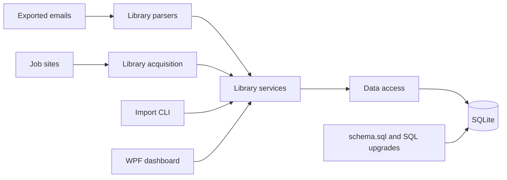

# Application Architecture

## Boundaries

The WPF dashboard and console are thin clients. The library owns initialization, validation, queries, imports, and acquisition sessions. Clients receive ordinary job collections and operation results. WPF owns selection, filtering for display, and pagination.

Business logic depends on typed models and focused interfaces. The target data-access DLL owns SQLite connections, EF mappings, persistence models, and repository implementations. Keep EF tracking and query types inside data access. Use one context per operation and keep network waits outside write transactions. Extract assemblies incrementally once shared model and interface ownership is clear.

Reuse shared submodule code where it fits. Fix or add generally useful functionality in the owning submodule. Keep JobsDb-specific policy and EF integration in this repository.

## Data Flow

The import CLI writes accepted jobs through the library. The dashboard reads stored jobs through the query service. The refresh service exists in the library and dashboard wiring is tracked separately. The [SQL-first database workflow](sqlFirstWorkflow.md) governs schema changes.

## Import and Lead Review

Treat email as a passive lead feed. Prioritize useful leads and explain matches using explicit criteria. Source count and repeated alerts are operational signals.

Read one .eml per exporter entry ID, taken from the filename stem. Decode its MIME body parts into the email model. Prefer HTML for structured digests and text for recruiter prose or fallback. Stage files before publishing a batch, then let the external exporter or script invoke the CLI. Parse offline and report unsupported formats, ambiguous candidates, and failures separately.

Deduplicate by source and stable posting identity. Preserve user-maintained notes, status, priority, and archive state, as well as richer source details missing from a partial refresh. An email timestamp can provide an estimated posting date until enrichment supplies a better date.

Sample exports confirmed that LinkedIn HTML contains structured listing cards and stable job IDs. Remogu and DirectlyApply samples expose destinations inside tracking links. DTCC samples expose job IDs directly. Dice and Indeed each have multiple templates, and some providers expose opaque links that require a separate identity decision. Keep raw email retention separate from job and application history.

## Logging

Configure LoggingFoundation at application entry points. The import CLI writes daily batch logs under `%LOCALAPPDATA%\JobsDb\Logs` and prints per-message explanations in the terminal. Keep email contents, access tokens, and credentials out of logs.

See [open tasks](Tasks.md) for implementation work.
