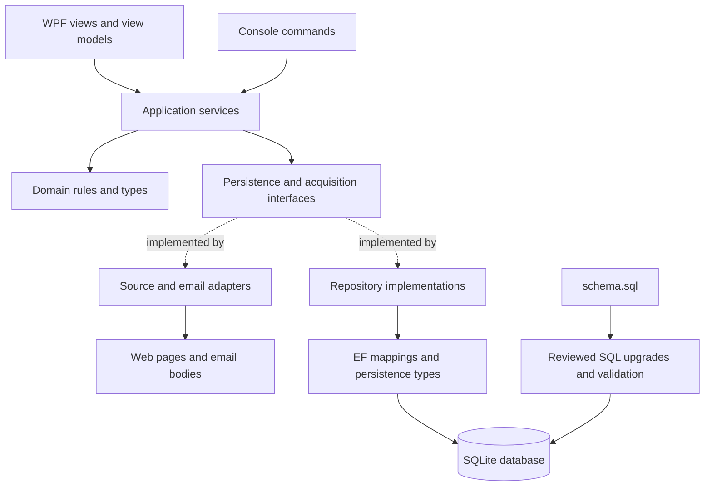

# Application Architecture

## Direction

Build a layered application intended for long-term maintenance. EF Core is an implementation under evaluation, not the organizing principle of the application. `SourceCode/Database/schema.sql` remains the authoritative database definition. The [SQL-first workflow](sqlFirstWorkflow.md) describes its tooling and upgrade plan.

## Responsibilities and Dependencies

| Layer | Responsibilities | Boundaries |
| --- | --- | --- |
| Presentation | WPF views and view models; console commands; input, selection, progress, and errors | Calls application services; contains no SQL, EF queries, database initialization, or parsing rules |
| Application | Use cases such as searching jobs, updating application status, and processing an import; coordinates validation and persistence | Depends on domain types and focused interfaces; owns operation and transaction boundaries without depending on EF types |
| Domain | Job identity, application state, and business rules | Has no dependencies on WPF, EF Core, database connections, or network clients |
| Infrastructure | Repository implementations, EF mappings, database connections, source acquisition, and email/file adapters | Implements the interfaces needed by application services; translates storage and external representations |

Dependency direction points toward application contracts and domain rules. Startup is the composition root: it chooses concrete implementations, configures dependencies, and owns application-wide resources. Windows, controls, and view models receive their dependencies rather than constructing infrastructure.

## Target Data Flow

Reads return application results through the services to the calling UI or command. Writes follow the same boundaries. SQL changes drive persistence mappings; they must not overwrite domain behavior or presentation models. This diagram describes the target, not completed wiring.

## Persistence Boundary

Keep generated storage classes and mapping configuration inside infrastructure. Preserve handwritten domain rules and enum semantics separately. Use separate persistence types where generation or storage semantics require them; avoid duplicating every class without a concrete need.

Interfaces should express actual operations, such as finding jobs or saving application notes. Do not expose `DbContext`, `DbSet`, `IQueryable`, or EF tracking requirements to callers. Return ordinary values or application result types with explicit write operations. Keep database contexts scoped to operations; do not share one context across concurrent UI and import work. Keep network waits outside database transactions.

Replacing EF would still require implementing and testing another persistence adapter. The boundary should contain that work rather than require changes throughout the UI and business rules.

## Current Gaps and Atomic Sequence

The target data-access DLL owns EF contexts, mappings, repository implementations, and any generated storage code. The core library focuses on business logic and consumes ordinary typed models through interfaces. ORM configuration stays inside data access. Database upgrades are SQL operations independent of either DLL. Decide ownership of shared models and interfaces before extracting projects; avoid circular dependencies and prevent data-access preparation from requiring business-layer compilation.

Database readiness checks now live in the library; startup invokes them once and owns context disposal. `MainWindow` still receives an EF context and calls repositories directly. Introduce a focused library initialization entry point so thin clients only initialize, obtain services, bind presentation, and display errors. That component coordinates setup and lifetime; business rules stay in focused services.

The console already has a thinner entry point: `JobsDbConsole/Program.cs` delegates live TokyoDev inspection to the library's `ScraperTester.TestTokyoDev`. Preserve that functioning path and reuse suitable library operations when extracting shared application services. This diagnostic path currently fetches and inspects HTML; it does not yet persist jobs. The dashboard and console should both consume shared services rather than depend on each other.

1. Establish SQL updates and database validation before application compilation. Keep EF as the ORM inside the data-access boundary; it does not own schema evolution.
2. Centralize database initialization and make resource ownership explicit.
3. Introduce the first focused application service and test its behavior independently of WPF and EF.
4. Connect dashboard job loading through a view model and that service, with SQLite integration coverage and a WPF binding smoke check.
5. Extend the same boundaries to writes and console operations. Keep scraper redesign deferred; apply these boundaries when that work resumes.

Keep each change reviewable. Establish logical boundaries first; split assemblies when enforcing dependency direction justifies it. Do not introduce generic repository frameworks, service buses, or a separate service process without a demonstrated requirement.
