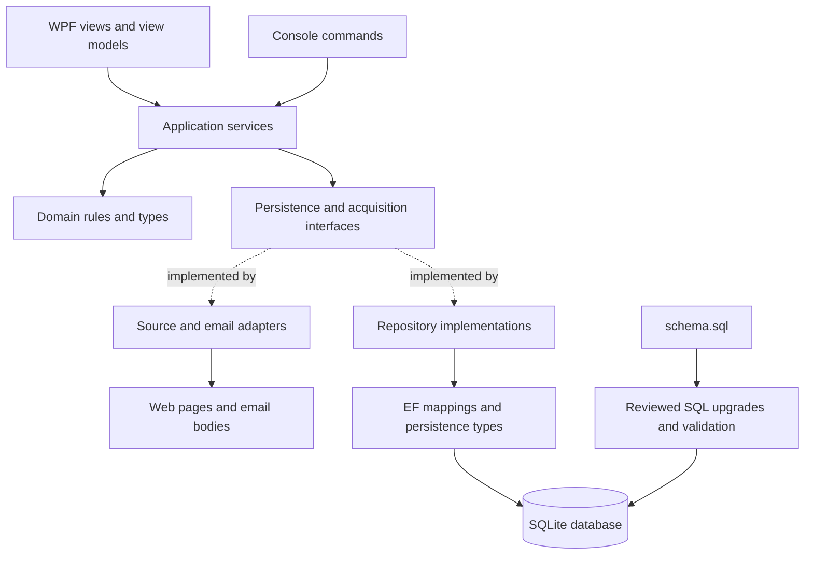

# Application Architecture

## Direction

Build a layered application intended for long-term maintenance. EF Core is an implementation under evaluation, not the organizing principle of the application. `SourceCode/Database/schema.sql` remains the authoritative database definition. The [SQL-first workflow](sqlFirstWorkflow.md) describes its tooling and upgrade plan.

## Responsibilities and Dependencies

| Layer | Responsibilities | Boundaries |
| --- | --- | --- |
| Presentation | WPF views and view models; console commands; input, selection, progress, and errors | Calls application services; contains no SQL, EF queries, database initialization, or parsing rules |
| Application | Use cases such as searching jobs, updating application status, and processing an import; coordinates validation and persistence | Depends on domain types and focused interfaces; owns operation and transaction boundaries without depending on EF types |
| Domain | Job identity, application state, and business rules | Has no dependencies on WPF, EF Core, database connections, or network clients |
| Infrastructure | Repository implementations, EF mappings, database connections, source acquisition, and email/file adapters | Implements the interfaces needed by application services; translates storage and external representations |

Dependency direction points toward application contracts and domain rules. The library initialization entry point chooses concrete implementations and configures dependencies. The client owns the initialized library lifetime. Windows, controls, and view models receive their dependencies rather than constructing infrastructure.

## Target Data Flow

Reads return application results through the services to the calling UI or command. Writes follow the same boundaries. SQL changes drive persistence mappings; they must not overwrite domain behavior or presentation models. This diagram describes the target, not completed wiring.

## Persistence Boundary

Keep generated storage classes and mapping configuration inside infrastructure. Preserve handwritten domain rules and enum semantics separately. Use separate persistence types where generation or storage semantics require them; avoid duplicating every class without a concrete need.

Interfaces should express actual operations, such as finding jobs or saving application notes. Do not expose `DbContext`, `DbSet`, `IQueryable`, or EF tracking requirements to callers. Return ordinary values or application result types with explicit write operations. Keep database contexts scoped to operations; do not share one context across concurrent UI and import work. Keep network waits outside database transactions.

Replacing EF would still require implementing and testing another persistence adapter. The boundary should contain that work rather than require changes throughout the UI and business rules.

## Current Gaps and Atomic Sequence

The target data-access DLL owns EF contexts, mappings, repository implementations, and any generated storage code. The core library focuses on business logic and consumes ordinary typed models through interfaces. ORM configuration stays inside data access. Database upgrades are SQL operations independent of either DLL. Decide ownership of shared models and interfaces before extracting projects; avoid circular dependencies and prevent data-access preparation from requiring business-layer compilation.

The WPF app now calls `LibraryManager.Initialize()` and disposes the manager on exit. The manager validates the existing database with a temporary context, disposes it before returning, and supplies query and refresh services. Scraper construction and registration stay inside the library; `ScraperService` is internal. Acquisition configuration is deferred until refresh is requested. Job loading now uses a focused query service returning complete, detached collections, ordered newest first with identifier tie-breaking. Active jobs are the default; archived jobs can be requested. The app owns pagination and presentation. The dashboard now binds a read-only job table and selected-job details through a view model. Loading, empty results, failures, retry, and reload selection are presentation concerns. The dashboard opens the selected HTTP/HTTPS posting in the default browser and explains when a full description has not been saved. The window receives only that view model and no longer calls repositories. Each job collection read now owns and disposes an independent context through a read-only persistence interface. Each refresh session now owns a separate context and scraper repositories, disposes its context after completion or failure, and rejects overlapping refresh requests per library manager. Configuration and source registration occur only when a session starts. The legacy repository properties and shared write context have been retired. Repository implementations remain available to infrastructure and tests; future editing and import services must own their write operations.

The console already has a thinner entry point: `JobsDbConsole/Program.cs` delegates live TokyoDev inspection to the library's `ScraperTester.TestTokyoDev`. Preserve that functioning path and reuse suitable library operations when extracting shared application services. This diagnostic path currently fetches and inspects HTML; it does not yet persist jobs. The dashboard and console should both consume shared services rather than depend on each other.

1. Establish SQL updates and database validation before application compilation. Keep EF as the ORM inside the data-access boundary; it does not own schema evolution.
2. Completed: centralize database initialization and resource ownership behind the library entry point.
3. Completed: introduce a focused job query service returning collections, with independent service tests and SQLite coverage for ordering, archive selection, and explicit saves.
4. Completed: connect dashboard job loading through a view model, with SQLite-to-WPF binding coverage. Dormant FUTURE_UI handlers have been removed; editing, searching, pagination, and acquisition controls remain separate follow-up work.
5. Extend the same boundaries to writes and console operations. Keep scraper redesign deferred; apply these boundaries when that work resumes.

Keep each change reviewable. Establish logical boundaries first; split assemblies when enforcing dependency direction justifies it. Do not introduce generic repository frameworks, service buses, or a separate service process without a demonstrated requirement.

## Maintenance Backlog

- Replace LinkedIn's authenticated scraping flow with unauthenticated guest/public listing access. Remove the LinkedIn credential prerequisite and login/challenge handling as part of that focused change. Verify search coverage and stable posting identity against representative guest-page fixtures before retiring the existing path. Scraper redesign remains deferred.
- Deferred, alongside LinkedIn scraper work: replace the hard-coded credential encryption password in LinkedInScraper with an externally supplied secret if credentials remain necessary, or remove that dependency when guest access eliminates it. Account for existing encrypted credentials before changing the encryption mechanism.
- Reduce build warnings in focused batches, starting with nullable-reference and resource-lifetime defects, then obsolete APIs and style. Keep warnings visible and review submodule cleanup separately. Configuration loading now retains defaults for null/invalid JSON, and credential lookups tolerate an absent collection.

## Dashboard Appearance Task

Use `TimeTracker/SourceCode/Product/TimeTracker` as the visual reference: standard WPF controls, simple spacing, a menu, and a status bar. Its `App.xaml` sets `ThemeMode="Dark"` without a custom theme package. In a separate UI iteration, offer System, Light, and Dark choices and persist the selection as a presentation preference. Check grid selection, descriptions, links, and disabled controls in each theme.

## Dashboard Refresh Task

Add a **Refresh Db** button that awaits a library-managed acquisition session, reloads the job collection, and updates the status line after completion. Report failures and partial results accurately. Prevent overlapping refresh sessions and database access against a shared context. The app presents progress and results; source registration, scraping, persistence, and coordination remain internal to the library. The acquisition button and its wiring are still pending; scraper redesign remains deferred.

## Email Import Plan

`Models/Email.cs` belongs in the core library: transport-independent input to processing, with no Outlook, file, or EF dependency. `HtmlBody` and `TextBody` are optional alternatives. Timezone precision is not a prerequisite for initial ingestion. Preserve the supplied timestamp and any known timezone; treat email-derived posting dates as estimates until the full posting provides a better value. `IsAggregate` identifies a recognized digest format; keep processing status separate.

### Findings From the Samples

`Emails/` contains 31 matching HTML/text pairs dated November 16–18, 2026. Both versions carry matching exported Sent/Sender metadata; HTML stores it in an escaped comment. These are decoded body exports, not MIME messages. The filenames resemble mailbox identifiers, but provide no verified Internet Message-ID, subject, or timezone offset.

| Samples | Parsing approach |
| --- | --- |
| LinkedIn: 10 digests, six job IDs each; 57 distinct IDs across 60 occurrences | Start here. Extract `/comm/jobs/view/{id}` links and surrounding title/company/location cards. Canonicalize to `/jobs/view/{id}/`; reuse the scraper's LinkedIn source identity. |
| Remogu and DTCC | Remogu embeds percent-encoded `/job/{id}/` destinations in tracking paths. DTCC exposes Oracle career-site job IDs directly. Parse their repeated listing blocks next. |
| DirectlyApply: two digests | Decode the `u` parameter offline; these samples expose two and three distinct `/job/{id}` destinations. The first featured job is not the entire email. |
| Indeed, ZipRecruiter, Wellfound, Lensa, Dice recommendations | Use separate template adapters. Extract cards, then establish stable identity before automatic insertion; several links are opaque trackers. |
| Recruiter messages through Dice, Siri, and Indeed | Usually single roles with prose or Role/Position/Location/Type labels. Some lack a usable posting link or employer; retain candidates for review. |
| IBM newsletter, Michael Page survey, Meridial signing reminder | Record skipped/unrecognized outcomes; career-related messages and action links are not necessarily job listings. |

### Atomic Sequence

1. Completed: the exported-pair reader joins matching basenames into one `Email`. It returns per-item read/ignored/failed outcomes and reasons; provider recognition is a later parsing step. Strip export metadata from bodies, HTML-decode metadata, validate matching headers, and report missing/conflicting values. Accept either body representation. Preserve timezone-free timestamps without silently converting to UTC.
2. Completed: the HTML LinkedIn parser uses HtmlAgilityPack and returns preliminary candidates, aggregate classification, and diagnostics without modifying emails or writing to the database. Sample validation yields 60 occurrences and 57 distinct IDs across ten digests. Text-only messages and unsupported templates are explicitly ignored for now; text fallback remains follow-up work. Extract structural cards rather than every hyperlink or page-wide regular expressions. When adding text fallback, do not import it as a second message. Normalize extraction whitespace while preserving original bodies and Japanese text. Add small representative fixtures for duplicate links, missing bodies, and changed templates.
3. Completed: the separate jobsdb console has import <directory> and help commands. It delegates to the library and reports per-message outcomes and job totals. Existing scraper diagnostics remain separate. JobsDbApplication is the renamed desktop project and executable; Git records the project moves.
4. Deferred: define email-content/provenance persistence in authoritative `schema.sql` and a reviewed SQL upgrade: `Emails` for original content and import metadata; `EmailJobs` linking multiple emails to the same job. Use PascalCase tables, camelCase columns, and the agreed integer-key syntax. Store parser version, processing status, errors, and a content fingerprint separately from `IsAggregate`. Mailbox identifiers are adapter-scoped; fingerprints support exact retries. Use the email sent date as a provisional posting-date estimate when necessary, recording its origin in import provenance; later enrichment can replace it with the posting date. Precise dates and a nullable-date schema change are not prerequisites for initial listings.
5. Completed for initial listings: the library importer parses before opening a short write transaction per email and stores accepted jobs in the existing Jobs table. No new schema is needed for this initial path; email provenance storage remains deferred. Reuse `(source, sourceJobId)` uniqueness across email and scraper imports. Preserve notes, application status, priority, and archive state when refreshing source-owned fields. Missing company or stable identity stays pending; approximate dates are acceptable for initial ingestion. Do not invent values to satisfy required columns or merge cross-provider jobs by title alone. Distinguish an email-derived date estimate from a date supplied by the posting.
6. Add provider parsers selected by sender and message structure. Include separate Dice recommendation/recruiter and Indeed alert/match/recruiter templates; one provider can send several message formats. Start with LinkedIn, then expand provider coverage in the order above. Decide bounded email retention before automatic deletion; keep job/application data independent of transient source messages.

Acquisition adapters stay outside business rules. Offline parsing must not open browsers, load remote images, or follow subscription, profile, application, or signing actions. Remove only known tracking parameters; preserve parameters carrying job identity. Keep opaque destinations unresolved. Schema changes and actual imports belong to subsequent iterations.

### Immediate Priority

Deliver a small end-to-end path from the supplied emails to real listings in the existing dashboard: pair reader, LinkedIn extraction/preview and a thin console trigger, minimal SQL-backed import with deduplication, then verify the dashboard against imported listings. Accept partial listing details and approximate dates; retrieve full postings through a later enrichment operation. Prefer HTML for structured digests because it preserves listing boundaries and destination links; use text for recruiter prose and fallback. Do not delay this path for complete provider coverage, a full enrichment engine, additional UI polish, or the physical data-access DLL split. The dashboard displays stored jobs, and the console importer now provides the initial ingestion path. Temporary-database validation imported 57 distinct sample listings; a repeat run added none, and the dashboard query returned those same 57 jobs.

### External Script Handoff

An external script gathers exporter output and publishes a completed batch in a directory such as Emails, then explicitly invokes the thin console runner with that directory. Use staging while copying so processing does not race partial files; a deliberately text-only or HTML-only export remains valid. Start with manual invocations; the same one-shot command can later be scheduled without adding a watcher or background service.

The library owns reading, provider recognition, parsing, deduplication, and persistence. The runner only forwards configuration and displays per-source outcomes plus totals. Unsupported extensions/export formats and unrecognized provider templates are ignored with a source identifier and reason, never silently discarded or counted as imported. Recognized malformed exports and processing failures are reported separately, without preventing other items from being examined. Return a nonzero process exit code for operational/processing failures; an otherwise successful batch with only ignored items can succeed with an explicit ignored count. The script can capture output into its own log.

Keep inputs unchanged initially. Persist import identity and processing outcomes with the later SQL-backed importer so repeated or scheduled runs do not create duplicate jobs. Do not treat a read email as a successfully parsed or imported email.

### Reuse Boundaries

The scraper implementations remain experimental and are not a correctness reference. HTML text cleanup and validated LinkedIn posting identity/canonical URLs now live in shared library utilities and have independent tests. Browser-page selectors and email-card selectors remain separate. The LinkedIn scraper now falls back to a validated data-job-id and skips cards without stable identity instead of creating random IDs; live scraper behavior has not been verified.

Before sharing persistence, extract and test source-field merge rules from JobScraperBase. Its current update helper overwrites fields wholesale. The initial email importer therefore updates only title, company, canonical URL, and a supplied location; it preserves descriptions, salaries, posting dates on existing jobs, and other richer information. Preserve application-owned status, notes, priority, and archive state. This merge service belongs to the import/persistence step, not the offline parser.

### Lead Quality

Email ingestion is a passive lead feed intended to reduce attention demands, duplication, and alert churn. Focused web searching remains complementary. Import counts and source counts are operational diagnostics and provenance, not measures of relevance. After this initial end-to-end path, prioritize reviewing/filtering leads against explicit user criteria and showing the reasons for a match before expanding provider coverage. Do not infer quality from repeated emails or the number of sites carrying a listing. No relevance scoring or automatic qualification is implemented yet. Follow-up: offer optional removal of UTM tracking parameters when opening posting links; preserve query parameters needed to identify or access the job.
